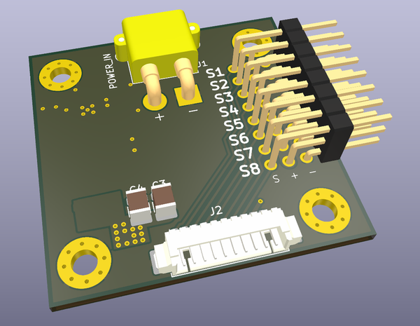
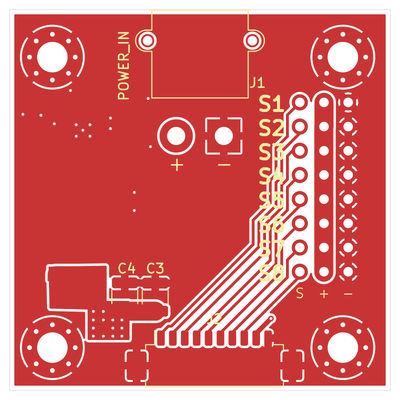
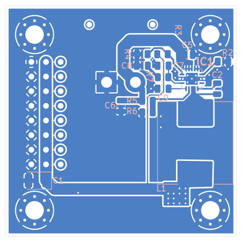

# Servo Hub

This is an older project that I updated slightly before publishing.

Eight-channel servo power and signal hub. A TPS54821RHLR converts a nominal 12 V input to 5 V, while S1–S8 pass directly from the controller to the servos.

- Input voltage — 12 V nominal, 17 V maximum.
- Output voltage — 5 V.
- Maximum total servo current — 8 A (design limit).

## 3D View

## PCB Topology

| Top copper and silkscreen | Bottom copper and silkscreen |
| --- | --- |
|  |  |

## Pinout

| Connector | Pins |
| --- | --- |
| J1 · XT30 power input | 1 = GND, 2 = VIN |
| J2 · PicoBlade controller input | 1–8 = S1–S8, 9 = +5 V, 10 = GND |
| J5 · Servo outputs | `S` = signal, `+` = 5 V, `−` = GND |

J2 pin 9 shares the servo 5 V rail. Check for backfeeding if the controller has a separate supply.

## Project files

- [KiCad 9 project](board/servo_manager.kicad_pro) · [Schematic PDF](board/release/servo_manager-schematic.pdf)
- [Gerber ZIP](manufacturing/gerber/servo_manager-gerber.zip) · [Drill files](manufacturing/drill/) · [BOM](manufacturing/bom/servo_manager-bom.csv) · [Pick and place](manufacturing/pick-and-place/)

Before fabrication, reconcile the IC1 footprint link and the J2 mounting pads with the schematic.

## License

Project files are released under the [MIT License](LICENSE). Third-party libraries and 3D models retain their respective terms.
